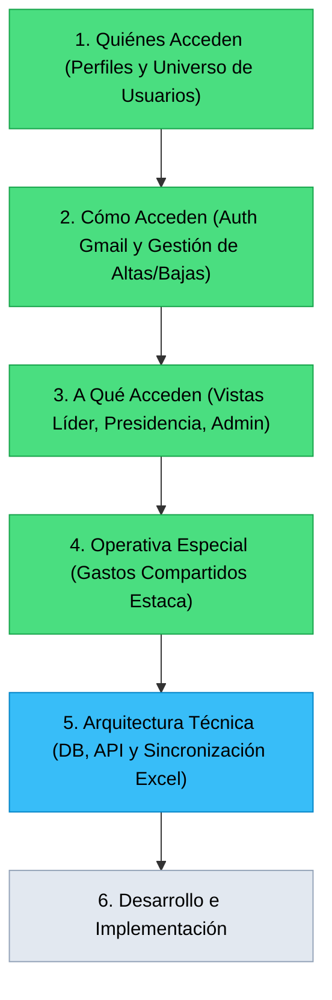

# ROADMAP_PROGRESS.md - Estado y Plan de Avance del Proyecto

> **Fase Actual**: Reestructuración Integral de Requerimientos y Flujos de Usuario (Paso 1: Quiénes Acceden)  
> **Última Actualización**: 2026-11-05

---

## 📊 Estado de las Fases del Nuevo Enfoque

---

## 📝 Estado de Definición Paso a Paso

### ✅ Paso 1: Quiénes Acceden (Completado y Aprobado)
- [x] Catálogo completo de roles: Líderes, Presidencia, Administradores.
- [x] Definición de integrantes de Presidencia (6 miembros: Presidente, Secretario Financiero, Secretario, 1° y 2° Consejero, Secretario Ejecutivo).
- [x] Regla de protección inmutable: Presidente y Secretario Financiero son administradores permanentes no revocables.
- [x] Estructura de equipos por organización (Presidente/a, consejeros, secretarios, asesores; ~4 integrantes o más).
- [x] Universo total de usuarios estimado: ~38 a 46 personas.

### ✅ Paso 2: Cómo Acceden y Gestión de Usuarios (Completado y Aprobado)
- [x] Flujo de autenticación con Google (Google Sign-In nativo sin pantallas rojas de riesgo).
- [x] Mensaje oficial para no autorizados: *"Acceso restringido. Ponte en contacto con el administrador o un miembro de la presidencia de Estaca."* (contacto directo vía WhatsApp/teléfono).
- [x] Hub de Inicio diferenciado para Presidencia (Dashboard + Organizaciones) y Administradores (agrega Gestión de Usuarios y Centro de Edición y Carga).
- [x] Panel de Gestión de Usuarios: Rol de Administrador exclusivo para miembros de Presidencia (imposible para líderes).
- [x] Permiso granular en Presidencia para "Aprobar Actividades Propuestas" (restringido para secretarios salvo delegación expresa).
- [x] Bajas lógicas (desactivación de cuenta) para preservar trazabilidad histórica.

### ✅ Paso 3: A Qué Acceden según su perfil (Completado y Aprobado)
- [x] Vista del Líder:
  - Saldo actual y próxima actividad con costo visible.
  - Historial anual de gastos y Calendario anual en secciones colapsables (desplegables) para mantener la interfaz despejada.
  - Checkbox "Seminario" en MJ y HJ para vincular eventos visibles en ambas organizaciones simultáneamente.
- [x] Hub de Presidencia:
  - Botón a Dashboard Ejecutivo (presupuesto global, apertura anual + ingresos trimestrales acumulativos, gráfico de asignación porcentual, tarjetas de organizaciones con barras de progreso verde/rojo).
  - Botón a Bandeja de Aprobación de Actividades con borde/indicador parpadeante de alerta cuando hay propuestas pendientes (con opciones: Aprobar, Rechazar, Editar).
  - Botones a cada Organización (vista espejo idéntica a la del líder).
- [x] Vista de Administrador:
  - Botón `Gestión de Usuarios` con regla de auto-protección (ningún admin puede quitarse sus propios permisos ni eliminarse; texto explicativo en cabecera).
  - Botón `Centro de Edición y Carga Operativa` (gastos, retiros, ingresos trimestrales, ajustes LCR, actividades directas).

### ✅ Paso 4: Operativa Especial (Gastos Compartidos Estaca) (Completado y Aprobado)
- [x] Aprobada la **Opción B**: Las actividades generales de Estaca no alteran el presupuesto asignado original de las organizaciones.
- [x] Formulario administrativo `Distribuir Gasto de Actividad de Estaca` para prorratear importes entre las organizaciones involucradas.
- [x] Asiento como gasto transparente en cada organización con la etiqueta `Actividad General de Estaca: [Nombre Evento]`, cuadrando con LCR y la barra visual.

### ⏳ Paso 5: Arquitectura Técnica y Sincronización Excel (Completado y Auditado)
- [x] Selección del stack moderno: **Vercel** (Frontend PWA) + **Supabase** (PostgreSQL gratuito con Google Auth nativo).
- [x] Modelo de sincronización Excel aprobado: Opción 1 (Botones `📥 Exportar Excel` y `📤 Importar Excel` en Web App; Excel como respaldo/backup local).
- [x] Documentación y modelado del circuito de retiros, excedentes de efectivo, reutilización entre actividades y redepósitos.
- [x] Carga de gastos con autocompletado inteligente `MMDD-MONTO` y casilla para liberar referencia numérica en gastos directos con tarjeta/banco.
- [x] Gestión de gastos compartidos con otras Estacas/unidades aprobada (Solución 1: Monto Bruto LCR vs. Reintegro Externo = Gasto Neto Organización).
- [x] Depuración y verificación final de [`Ejemplo_DB_Finanzas.xlsx`](file:///g:/Mi%20unidad/Estaca/Finanzas/APP_DB/Ejemplo_DB_Finanzas.xlsx):
  - **0 vínculos externos**: libro 100% autónomo.
  - Hoja `00_Directorio_Lideres` activa con miembros de Presidencia, Sumo Consejo y líderes de organizaciones.
  - Hoja `06_Directorio_Proveedores` incorporada y poblada con 17 proveedores reales con RUT, rubro, contacto y requisito de boleta fiscal.
  - Tabla de Conciliación en vivo en primera posición con métricas exactas de LCR: Retiros sin Justificar ($21.500,00), Total sin Justificar ($23.558,00), Gastos sin Rendir ($15.506,00) y Diferencia ($8.052,00).
  - Tarjetas KPI: Presupuesto Total Recibido ($419.773,09), Gastos No Reembolsables ($305.605,00), Gastos Reembolsables ($195.559,71), Saldo LCR ($129.674,09) y Saldo Real Disponible ($114.168,09).
  - Verificación 100% cruzada con el reporte completo de 84 movimientos de LCR (transferencias trimestrales desglosadas por unidad, gastos, ajustes y reintegros OAI).
- [x] Tarea de Integración de Calendario LCR completada:
  - Feed verificado y funcional vía endpoint oficial de grupo: `https://churchofjesuschrist.org/church-calendar/services/ext/v3.0/export/ical/group/cd92d6817fa64d25bc2f55aec4fea180`.
  - Detección automática de reprogramaciones y cancelaciones mediante `UID` estándar iCal.
  - Insignia visual destacada para actividades que conllevan presupuesto.
  - Guardado en hoja `00_Configuracion` del libro Excel maestro.
- [x] Arquitectura de Frontend aprobada: **Opción A (PWA Unificada con Enrutamiento RBAC)**. Un solo despliegue con vistas dinámicas según perfil (Líder / Presidencia / Admin).
- [ ] Tarea en curso: Evaluación e instalación de skills / repositorios de diseño UI/UX.
- [ ] Tarea siguiente: Verificación de cuentas (Vercel y GitHub) e inicio del desarrollo del Frontend + Supabase.
  - Impacto en el indicador porcentual real asignado vs. ejecutado.
  - Visualización del movimiento para el líder de la organización afectada.
- [ ] Aprobación formal del usuario para avanzar al Paso 5.

### ⏸️ Paso 3: A Qué Acceden según su perfil
- [ ] Pantalla móvil del líder (saldo, próxima actividad, historial simple, proponer actividad).
- [ ] Pantalla de Presidencia (selector inicial: Dashboard ejecutivo o vista por organización).
- [ ] Dashboard de Presidencia (presupuesto global, acumulación trimestral, distribución porcentual, tarjetas y barras de progreso verde/rojo).
- [ ] Panel de Administrador (aprobación de actividades, carga ágil de gastos/retiros, conciliación LCR).

### ⏸️ Paso 4: Operativa Especial (Gastos Compartidos)
- [ ] Metodología para actividades generales de Estaca que descuentan fondos a organizaciones.

### ⏸️ Paso 5: Arquitectura Técnica y Modelo de Datos
- [ ] Definición del motor de Base de Datos y sincronización/exportación a Excel simplificado.

---

## 📝 Detalle de Tareas

### ✅ Fase 1: Análisis y Diagnóstico Funcional (Completada)
- [x] Inspección técnica y descompilación de código VBA de `2024.xlsm` (Agenda dinámica, `Worksheet_SelectionChange`, `frmCRUD`, `frmBuscar`, matrices dinámicas `FILTER`/`MMULT`).
- [x] Análisis de datos y fórmulas de `2026 Finanzas.xlsm` (`Dashboard`, `Panel Cont`, `Registro Cont`).
- [x] Identificación de referencias huérfanas `#REF!` y elementos descartables (`CuentasDepo`).
- [x] Relevamiento del intento inicial con Gemini Spark y sus archivos `.gdoc`/`.gsheet`.

### ✅ Fase 2: Definición de Requerimientos y Arquitectura (Completada)
- [x] Definición de perfiles de usuario (Líder móvil vs. Administrador PC/móvil).
- [x] Establecimiento de la matriz RBAC para 22 usuarios con aislamiento por organización.
- [x] Definición de la regla especial de Seminario (fondo común para MJ y HJ).
- [x] Definición de la regla de Estaca (remanente de asignaciones de organizaciones).
- [x] Modelo de datos relacional normalizado en 5 tablas maestras.
- [x] Selección del stack: Google Sheets (BD) + Google Apps Script Web App (Frontend PWA).

### ✅ Fase 3: Organización de Workspace y Configuración del Harness (Completada)
- [x] Evaluación y descarte justificado de `rsc-harness`.
- [x] Reorganización de la carpeta `APP_DB`:
  - `_ARCHIVADO/OLD_SPARK/`: Respaldo de los 4 archivos de la planificación inicial de Spark.
  - `_ARCHIVADO/REFERENCIA_EXCEL/`: Copia de respaldo de `2024.xlsm` y `2026 Finanzas.xlsm`.
- [x] Creación del sistema de memoria persistente en `.gemini/`:
  - [`GEMINI.md`](file:///g:/Mi%20unidad/Estaca/Finanzas/APP_DB/GEMINI.md)
  - [`PROJECT_CONTEXT.md`](file:///g:/Mi%20unidad/Estaca/Finanzas/APP_DB/.gemini/PROJECT_CONTEXT.md)
  - [`DECISION_LOG.md`](file:///g:/Mi%20unidad/Estaca/Finanzas/APP_DB/.gemini/DECISION_LOG.md)
  - [`ROADMAP_PROGRESS.md`](file:///g:/Mi%20unidad/Estaca/Finanzas/APP_DB/.gemini/ROADMAP_PROGRESS.md)

---

### ✅ Fase 4: Creación de la Base de Datos Maestra y Migración (Completada y Auditada)
- [x] Creación del archivo maestro [`DB_Finanzas_Calendario.xlsx`](file:///g:/Mi%20unidad/Estaca/Finanzas/APP_DB/DB_Finanzas_Calendario.xlsx) en la raíz de `APP_DB`.
- [x] Reconstrucción v2 con correcciones exhaustivas solicitadas por el usuario:
  - **Convención MMDD-MONTO corregida**: Interpretación exacta de fechas de retiro y gastos (`1012-25000` = 12/10/2026, `1017-12500` = 17/10/2026). Formato visual `dd/mm/aaaa`.
  - **Devoluciones de sobrantes**: Incorporación de `Fecha_Devolucion` en `RETIROS_FONDOS` (01/06/2026 para $1.241 y 02/08/2026 para $1.506), conciliando a $0.00 (`Cerrado en Cero`).
  - **Gastos reembolsables**: Campo `Es_Reembolsable` ("SI"/"NO"). Los egresos reembolsables (como MeetUP) no descuentan del presupuesto de las organizaciones (`=SUMIFS(..., Es_Reembolsable, "NO")`).
  - **Alertas rojas LCR precisas**: Marcadas únicamente en los 2 egresos pendientes de asentar en LCR ($12.394 Primaria y $3.112 Coro Estaca).
  - **Depuración de Calendario**: 18 actividades reales ejecutadas en 2026 (sin fechas inventadas futuras). Columna `Lugar` agregada.
- [x] Formato de fecha uniforme `dd/mm/aaaa` y formato numérico oficial sin símbolo pesos `#.##0,00` configurado por el usuario.
- [x] Cuadre financiero total verificado contra `2026 Finanzas.xlsm`.

---

### ✅ Fase 5: Backend y Lógica de Negocio (Google Apps Script) (Completada)
- [x] Creación de la estructura del backend en carpeta [`gas/`](file:///g:/Mi%20unidad/Estaca/Finanzas/APP_DB/gas):
  - [`appsscript.json`](file:///g:/Mi%20unidad/Estaca/Finanzas/APP_DB/gas/appsscript.json): Manifiesto V8 con zona horaria `America/Montevideo` y configuración Web App.
  - [`Database.js`](file:///g:/Mi%20unidad/Estaca/Finanzas/APP_DB/gas/Database.js): Capa de acceso a datos (DAL) para Google Sheets (`getAll`, `insertRow`, `updateRowById`, conversor de fechas/horas).
  - [`Auth.js`](file:///g:/Mi%20unidad/Estaca/Finanzas/APP_DB/gas/Auth.js): Control de acceso por roles (RBAC) validando correo Google, aislamiento de organizaciones para líderes, regla de Seminario compartida (`MJ` y `HJ`), y permisos ampliados para Presidencia y Admin.
  - [`Code.js`](file:///g:/Mi%20unidad/Estaca/Finanzas/APP_DB/gas/Code.js):
    - `doGet(e)`: Servicio de la Web App HTML5 responsiva.
    - `apiGetInitialContext()`: Validación de sesión y perfil de usuario activo.
    - `apiGetDashboardData(anio, orgs)`: Agregación de presupuesto anual y trimestral, historial de gastos (simplificado para líderes, detallado para Presidencia), calendario de actividades y resumen de conciliación de retiros y alertas LCR.
    - `apiProponerActividad(datos)`: Inserción validada de propuestas de eventos con generación automática de correlativo `ACT-YYYY-XXX`.
    - `apiGuardarGasto(datos)` y `apiConciliarLCR(idGasto, estado)`: Operaciones financieras exclusivas del Administrador.

---

### ✅ Fase 6: Frontend Responsivo Mobile-First (Completada)
- [x] Creación de [`Index.html`](file:///g:/Mi%20unidad/Estaca/Finanzas/APP_DB/gas/Index.html) en `gas/`:
  - **Diseño Mobile-First**: Estilo tarjeta de billetera digital con gradiente, tipografía Inter y Tailwind CSS.
  - **Formato Oficial de Importes**: Todos los montos renderizados como `#.##0,00` (sin `$`, punto para miles, coma para dos decimales).
  - **Pestaña Presupuesto**: Saldo anual disponible, progreso porcentual con colores dinámicos, desglose trimestral (T1-T4) y gráfico comparativo Chart.js.
  - **Pestaña Gastos**: Vista móvil simplificada (Fecha, Monto, Actividad) para líderes; vista ampliada con estado LCR para Presidencia/Admin.
  - **Pestaña Calendario**: Tarjetas de actividades con fecha, hora, lugar y presupuesto estimado.
  - **Pestaña Control/Retiros**: Resumen de fondos retirados, devoluciones redepositadas y saldos a rendir con alertas visuales de comprobantes sin registrar en LCR.
  - **Modal Nativo `<dialog>`**: Formulario `+ Proponer Actividad` siguiendo los estándares de *Modern Web Guidance* (backdrop blur, focus trap automático, accesibilidad y cierre al pulsar fuera).
  - **Mejoras Visuales Aplicadas (31/10)**:
    - Encabezado con pastilla azul `"Estaca Montevideo Uruguay Este"` y `"Finanzas y Calendario"`.
    - Selector de año reubicado debajo del badge del usuario.
    - Recuadro principal con contraste oscuro sólido (sin destellos blancos que dificulten la lectura).
    - Textos oficiales actualizados: `SALDO ACTUAL`, `Disponible para utilizar`, `Anual Asignado`, `Gasto Realizados` y `Uso del presupuesto`.
    - Gráfica de distribución con selector interactivo de `Montos` y `Porcentajes (%)` para análisis de la Presidencia.
  - **Modo Simulación Local integrado**: Permite previsualizar e interactuar con la app directamente abriendo el archivo en Chrome o Edge sin necesidad de publicar primero.

---

### ⏳ Fase 7: Pruebas, Verificación y Despliegue en Google (Siguiente)
- [ ] Guardar `DB_Finanzas_Calendario.xlsx` como Hoja de Cálculo nativa de Google Sheets en Google Drive.
- [ ] Abrir el editor de Google Apps Script vinculado e importar los archivos de `gas/`.
- [ ] Implementar la Web App y verificar el flujo de autenticación con cuentas de líderes y presidencia.
- [ ] Probar la instalación como PWA en dispositivo móvil.
